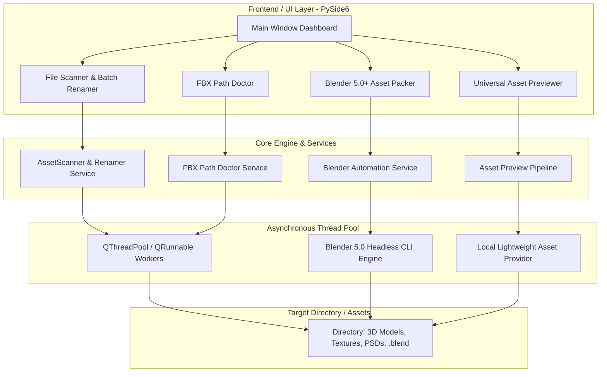

# 3D Asset Toolkit (Project P) - Architecture & Technical Specification

> **Target Implementer**: Claude Opus 5.5 (Lead Engineer & Optimizer)  
> **System Architect & Designer**: Antigravity  
> **Status**: Implemented — v1.0.0 (2026-10-26), see [CHANGELOG](CHANGELOG.md) for deviations from this draft  
> **Version Target**: v0.1.0-MVP -> v1.0.0 Production  

---

## 1. Executive Summary & Objective

**Project P (3D Asset Toolkit / 3D Asset Doctor)** is a lightweight desktop utility designed specifically for 3D Artists, Technical Directors (TDs), and Indie Game Developers. It eliminates the most frequent, tedious pipeline friction points:
1. **Asset Sanitation & Batch Renaming**: Flexible regex, rule-based presets (Unreal Engine / Unity / Custom DCC conventions), dry-run previews, and safe collision handling.
2. **FBX Absolute Path Doctor**: Deep scanning of `.fbx` files (both ASCII and Binary 7.x) to detect hardcoded local machine paths (e.g., `C:\Users\Artist\Desktop\...`), report broken texture linkages, and sanitize them to relative paths.
3. **Blender 5.0+ Asset Consolidation (Gom File)**: Headless CLI orchestration with Blender 5.0+ to pack resources, resolve external dependencies, remap paths relative to `//textures/`, and package clean export archives.
4. **Universal Multi-format Quick Previewer**:
   - **3D Meshes**: `.fbx`, `.obj`, `.glb`, `.gltf` with OrbitControls, Wireframe toggle, PBR texture mapping, and vertex/face count statistics.
   - **2D Textures & HDRs**: `.png`, `.jpg`, `.tga`, `.exr`, `.dds`, `.hdr`.
   - **Source Graphics**: `.psd` (Photoshop composite rendering & layer inspection).
5. **Bonus Pipeline Features** (Proposed): Unused texture detector, UV channel inspector, duplicate asset finder by mesh hash.

---

## 2. Recommended Tech Stack for Claude Opus

To ensure fast development, native cross-platform stability, and effortless integration with Blender 5.x Python scripts:

| Component | Recommended Technology | Rationale |
| :--- | :--- | :--- |
| **Language** | **Python 3.11+** | Native DCC ecosystem match; matches Blender 5.x internal Python. |
| **GUI Framework** | **PySide6 (Qt 6 for Python)** | Fast, responsive, robust threading for scanning large asset drives. Modern dark theme styling. |
| **3D Preview Engine** | **Three.js in QWebEngineView** (or `pywebview`) | Ultra-responsive WebGL/Three.js rendering for FBX/OBJ/GLTF with OrbitControls, grid, wireframe, and PBR shaders without bulky native OpenGL wrappers. |
| **FBX Parser** | Custom Binary/ASCII scanner + `pyfbx` / `fspy` fallback | Fast binary byte-pattern scanner for texture string extraction + path doctoring without requiring commercial Autodesk FBX SDK. |
| **Texture & PSD Support** | `Pillow`, `imageio`, `pytinyexr` / `OpenEXR`, `psd-tools` | Complete support for 2D textures, HDR/EXR floating point maps, and Adobe PSD composite previews. |
| **Blender Runner** | Standalone headless subprocess wrapper (`blender -b -P`) | Non-blocking background worker interacting with user's installed Blender 5.x binary. |
| **Packaging** | `PyInstaller` or `Nuitka` | Standalone `.exe` single executable or portable folder distribution for Windows. |

---

## 3. System Architecture & Flowchart



---

## 4. Module Specifications for Claude Opus 5.5

### Module A: File Scanner & Batch Renamer (`core/scanner.py` & `core/renamer.py`)
- **Features**:
  - Recursive folder scanning with format filters (`*.fbx`, `*.obj`, `*.glb`, `*.gltf`, `*.blend`, `*.psd`, `*.png`, `*.tga`, `*.exr`, `*.dds`).
  - Search & Replace, Prefix/Suffix, Regex matching, Case converters (camelCase, snake_case, PascalCase, UPPER_CASE).
  - **Preset Engine**: Built-in Unreal Engine naming conventions:
    - Meshes: `SM_<AssetName>`
    - Skeletal Meshes: `SK_<AssetName>`
    - Textures: `T_<AssetName>_D` (Diffuse), `_N` (Normal), `_R` (Roughness), `_M` (Metallic), `_ORM` (Occlusion/Roughness/Metallic).
  - **Dry-run & Collision Check**: Shows side-by-side Before/After table with status indicators (`OK`, `Warning: Collision`, `Skipped`).
  - **Safe Undo Stack**: Maintains a transaction history (`.rename_history.json`) to reverse operations in 1 click.

### Module B: FBX Absolute Path Doctor (`core/fbx_doctor.py`)
- **Pain Point**: FBX files exported from 3ds Max/Maya often encode hardcoded paths like `C:\Users\John\Projects\Textures\wood.png`. Opening these on other workstations or render farms breaks all material links.
- **Features**:
  - Fast stream scanner reading both ASCII (`.fbx` text) and FBX Binary 7.x (`FBX\0...`).
  - Extract all `RelativeFilename` and `FileName` properties under `NodeAttribute` / `Video` / `Texture` records.
  - Detect path types:
    * `ABSOLUTE_LOCAL` (e.g. `C:\...` or `D:\...`)
    * `UNC_NETWORK` (e.g. `\\server\share\...`)
    * `RELATIVE_PORTABLE` (e.g. `textures/wood.png` or `.\wood.png`)
  - **Fix Modes**:
    1. **Convert to Relative**: Rebase to a target folder or relative `./textures/` directory.
    2. **Strip to Basename**: Replace `C:\path\to\file.png` with just `file.png`.
    3. **Safe Copy / Relink**: Collect found textures into a subfolder and update paths in-place (with automatic backup `*.fbx.bak`).

### Module C: Blender 5.0+ Asset Consolidator ("Gom File") (`core/blender_packer.py`)
- **Features**:
  - Automatically detect installed Blender 5.0+ execution paths (from Windows Registry, `PATH`, or standard directories `C:\Program Files\Blender Foundation\Blender 5.0`).
  - Run headless script (`blender -b "<blend_file>" -P "<packer_script.py>" -- <args>`).
  - **Packing Operations**:
    1. **Pack All**: Pack all embedded images, sounds, fonts into the `.blend` file (`bpy.ops.file.pack_all()`).
    2. **Unpack & Consolidate**: Unpack existing files into a standardized `//textures/` or `//assets/` directory adjacent to the `.blend` file.
    3. **Make Paths Relative**: Execute `bpy.ops.file.make_paths_relative()` across all data blocks (materials, image nodes, library overrides).
    4. **Report Broken Dependencies**: Output a clean JSON report of missing external files (missing texture files).

### Module D: Universal Multi-Format Previewer (`core/preview/`)
- **Features**:
  - **3D Viewport**:
    - Embedded Three.js canvas in `QWebEngineView` (local static HTML/JS template).
    - Supports `.gltf`, `.glb`, `.obj` directly via Three.js standard loaders (`GLTFLoader`, `OBJLoader`, `FBXLoader`).
    - Standard camera OrbitControls, grid floor, HDRI / ambient studio lighting, and toggleable wireframe mode.
    - Model inspect stats: Vertex count, polygon/triangle count, material slots, bounding box dimensions.
  - **Texture & HDR Viewer**:
    - High-performance pan/zoom image viewport for `.png`, `.jpg`, `.tga`, `.dds`, `.exr`, `.hdr`.
    - Exposure & gamma sliders for floating-point HDR/EXR maps.
    - Alpha channel toggle (RGB only vs. RGBA vs. Alpha as grayscale).
  - **Photoshop PSD Viewer**:
    - Uses `psd-tools` to extract full composite image without needing Adobe Photoshop installed.
    - Displays layer tree with visibility toggles and dimensions.

---

## 5. Directory Structure for the Codebase

Claude Opus 5.5 should follow this clean layout:

```text
Project_P/
├── docs/
│   ├── ARCHITECTURE_AND_SPECS.md   <-- (This blueprint document)
│   ├── CHANGELOG.md                <-- (Changelog tracking each milestone)
│   └── USER_GUIDE.md               <-- (End-user documentation)
├── src/
│   ├── app.py                      <-- Application entry point
│   ├── core/
│   │   ├── __init__.py
│   │   ├── scanner.py              <-- Recursive scanning, filtering, hashing
│   │   ├── renamer.py              <-- Batch renaming rules, regex, undo engine
│   │   ├── fbx_doctor.py           <-- Binary & ASCII FBX path parser/fixer
│   │   ├── blender_packer.py       <-- Blender 5.0+ headless CLI controller
│   │   └── preview_service.py      <-- Texture & PSD converter backend
│   ├── blender_scripts/
│   │   └── headless_pack.py        <-- Script injected into Blender 5.x CLI
│   ├── ui/
│   │   ├── __init__.py
│   │   ├── main_window.py          <-- Main application window with tab navigation
│   │   ├── theme.py                <-- Dark modern DCC theme styling
│   │   ├── tabs/
│   │   │   ├── tab_renamer.py      <-- Batch rename view
│   │   │   ├── tab_fbx_doctor.py   <-- FBX path scan & fix view
│   │   │   ├── tab_blender.py      <-- Blender 5.0+ pack & consolidate view
│   │   │   └── tab_preview.py      <-- 3D/Texture/PSD preview view
│   │   └── web/
│   │       ├── viewer3d.html       <-- Three.js WebGL 3D viewer template
│   │       ├── three.min.js        <-- Standalone bundled Three.js
│   │       └── OrbitControls.js    <-- Camera controls
│   └── utils/
│       ├── __init__.py
│       ├── logger.py               <-- Structured logging
│       └── file_helpers.py         <-- Path sanitization, mime types, checksums
├── requirements.txt                <-- Python dependencies
└── README.md                       <-- Project quickstart
```

**As implemented (v1.0.0)**, the layout above is kept, with these additions:

```text
src/ui/workers.py            QThreadPool worker with progress / cancel injection
src/ui/widgets.py            PathPicker, BaseTab and small helpers shared by tabs
src/ui/image_viewer.py       Pan/zoom QGraphicsView with checkerboard and pixel picking
src/ui/tabs/tab_tools.py     Duplicate finder + unused texture detector (bonus features)
src/ui/web/vendor/           Three.js r170 ES modules (three.module.min.js + jsm/ add-ons)
                             (replaces three.min.js / OrbitControls.js: upstream no longer ships UMD builds)
tests/                       pytest suite + fixture generators (tests/fixtures/)
run.bat, pytest.ini          Launcher and test configuration
```

---

## 6. Implementation Priorities & Milestones for Claude Opus

Claude Opus 5.5 should implement the project in structured phases:

- [x] **Phase 1: Environment & Core Engine**
  - Setup `requirements.txt` with dependencies (`PySide6`, `psd-tools`, `Pillow`, `imageio`, `pywebview` or `PySide6.QtWebEngineWidgets`).
  - Implement `core/renamer.py` with presets (Unreal/Custom) and undo buffer.
  - Implement `core/fbx_doctor.py` to parse and strip/rebase hardcoded paths in both ASCII & Binary FBX.
- [x] **Phase 2: Blender 5.0+ Integration**
  - Implement `blender_scripts/headless_pack.py` with `bpy` operations (`pack_all`, `make_paths_relative`, texture consolidation).
  - Implement `core/blender_packer.py` subprocess runner with automatic path discovery.
- [x] **Phase 3: Universal Previewer Engine**
  - Implement `psd-tools` and HDR/TGA/DDS image decoding to QPixmap / QImage.
  - Implement the embedded Three.js WebGL canvas (`viewer3d.html`) supporting `.glb`, `.obj`, `.fbx`.
- [x] **Phase 4: Modern PySide6 UI & Polish**
  - Integrate all tabs into `src/ui/main_window.py` with dark DCC studio styling.
  - Add drag-and-drop folder/file support across all tabs.
  - Add execution logging and progress bars.
- [x] **Phase 5: Self-Testing, Validation & Changelog Update**
  - Run self-tests on sample mock files (FBX with absolute paths, sample textures, sample .blend).
  - Record achievements in `docs/CHANGELOG.md`.
