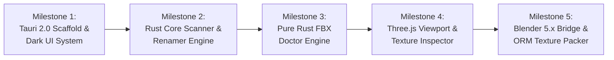

# 3D Asset Toolkit (Project P) - Architecture & Technical Specification V2 (Tauri 2.0 + Rust)

> **Target Implementer**: Claude Opus 5.5 (Lead Engineer & Optimizer)  
> **System Architect & Designer**: Antigravity  
> **Status**: Approved for Migration — v2.0.0 Architecture Specification  
> **Date**: 2026-10-26  
> **Supersedes**: [ARCHITECTURE_AND_SPECS.md](ARCHITECTURE_AND_SPECS.md) (Python/PySide6 Prototype)

---

## 1. Executive Summary & Migration Motivation

Project P v1.0 successfully validated the business logic and algorithms for 3D asset cleanup:
- Regex and Industry Preset batch renaming with undo transactions.
- Parsing and rewriting absolute texture paths in both Binary 7.x (32/64-bit) and ASCII FBX.
- Headless orchestration with Blender 5.0+ to pack and consolidate assets.
- Multi-format 2D/3D inspection (Three.js WebGL, HDR/EXR, PSD).

### Why Migrate from Python/PySide6 to Tauri 2.0 (Rust + Web)?
1. **Zero Runtime Overhead & Instant Startup**: The Python + PySide6 + QWebEngine distribution bundles an entire CPython interpreter, Qt runtime, and Chromium browser (~250MB+ bundle, 2–4s cold start, 300–600MB idle RAM). Tauri 2.0 leverages Windows WebView2, compiling to a clean **~15–25MB native binary** with **sub-second launch time** and **<60MB RAM footprint**.
2. **CPU-Bound Concurrency**: Asset drives frequently contain tens of thousands of textures and gigabytes of meshes. Rust's `rayon` and memory-safe parallelism process file hashing, byte scanning, and directory traversal at 10x–50x CPython speed without GIL lockup.
3. **Studio-Grade UI/UX**: PySide6 QSS styling is notoriously fragile for complex animations, responsive panels, and modern micro-interactions. A modern Web Frontend (React 19 or Svelte 5 + TailwindCSS + Lucide Icons) unlocks a sleek, high-end DCC Studio dark theme (Unreal Engine 5 / Linear / Substance style), Command Palette (`Ctrl+K`), and direct Three.js WebGL integration without needing a local HTTP server bridge.
4. **Clean DCC Isolation**: Blender 5.0+ remains controlled via headless CLI (`blender -b -P`), maintaining 100% compatibility while keeping the main application completely decoupled from Python runtime dependencies.

---

## 2. Technology Stack & Dependencies

```
┌────────────────────────────────────────────────────────────────────────┐
│                        FRONTEND (UI / UX Layer)                        │
│   React 19 / Svelte 5  •  Tailwind CSS v4  •  Lucide Icons             │
│   Three.js (WebGL Viewport)  •  Zustand / Svelte Stores  •  Radix UI   │
└───────────────────────────────────┬────────────────────────────────────┘
                                    │ Tauri 2.0 IPC (Invoke / Events)
                                    │ Custom Asset Protocol (asset://)
┌───────────────────────────────────▼────────────────────────────────────┐
│                       BACKEND (Rust Core Engine)                       │
│   tauri 2.x  •  rayon (Parallelism)  •  walkdir  •  serde / serde_json │
│   byteorder (FBX Binary Parser)  •  regex  •  image-rs  •  xxhash-rust │
└───────────────────────────────────┬────────────────────────────────────┘
                                    │ std::process::Command (JSON IPC)
┌───────────────────────────────────▼────────────────────────────────────┐
│                    DCC INTEGRATION (Headless Subprocess)               │
│   Blender 5.0+ Python (headless_pack.py)                              │
└────────────────────────────────────────────────────────────────────────┘
```

### 2.1 Backend (Rust)
- **Framework**: `tauri` v2.x with `tauri-build`
- **Concurrency & I/O**: `rayon` (data parallelism), `walkdir` (recursive traversal), `tokio` (async tasks)
- **Serialization**: `serde`, `serde_json`
- **Binary Parsing & Hashing**: `byteorder` (little/big endian handling), `xxhash-rust` (xxh3 64-bit hashing for rapid duplicate checking), `flate2` (zlib stream inflate/deflate for compressed FBX properties)
- **Text & Patterns**: `regex`, `wildmatch`
- **Image Processing**: `image` crate (PNG, TGA, JPEG, WebP, HDR decoding and ORM channel packing)

### 2.2 Frontend (Web)
- **Framework**: **React 19** (TypeScript) or **Svelte 5**
- **Styling**: **Tailwind CSS v4** with a custom Dark Studio Palette:
  - Deep Charcoal Canvas: `#0f1115`
  - Panel Surfaces: `#161920`, `#1d222c`
  - Subtle Borders: `rgba(255, 255, 255, 0.08)`
  - Accents: Electric Blue `#3b82f6`, Studio Amber `#f59e0b`, Status Emerald `#10b981`, Hazard Rose `#ef4444`
- **Icons**: `lucide-react` / `lucide-svelte`
- **3D Viewport**: `three` (r160+) with `OrbitControls`, `GLTFLoader`, `OBJLoader`, `FBXLoader`
- **State Management**: `zustand` (React) or Svelte Runes

---

## 3. Core System Architecture & Modules

```
project-p/
├── src-tauri/                       <-- Rust Backend
│   ├── Cargo.toml
│   ├── tauri.conf.json
│   └── src/
│       ├── main.rs                  <-- Tauri entrypoint
│       ├── lib.rs                   <-- Tauri plugin & command setup
│       ├── commands/                <-- Tauri IPC handlers
│       │   ├── scanner_cmd.rs
│       │   ├── renamer_cmd.rs
│       │   ├── fbx_cmd.rs
│       │   ├── blender_cmd.rs
│       │   ├── preview_cmd.rs
│       │   └── tools_cmd.rs
│       ├── core/                    <-- Pure Rust domain logic
│       │   ├── scanner.rs           <-- Fast parallel directory walker
│       │   ├── renamer.rs           <-- Regex, UE5/Unity presets, undo log
│       │   ├── fbx/                 <-- Pure Rust FBX parser & rewriter
│       │   │   ├── reader.rs        <-- Binary 7.x + ASCII stream decoder
│       │   │   ├── writer.rs        <-- Byte-accurate FBX serializer
│       │   │   ├── node.rs          <-- FBX Node tree & Property types
│       │   │   └── doctor.rs        <-- Path classifier & fix engine
│       │   ├── blender_runner.rs    <-- Subprocess caller for Blender 5.0+
│       │   ├── image_ops.rs         <-- Texture channel pack (ORM), downscale
│       │   └── duplicate_finder.rs  <-- Multithreaded xxh3 hash analyzer
│       └── utils/
│           ├── paths.rs             <-- Cross-platform path sanitation
│           └── history.rs           <-- Transaction log (.rename_history.json)
├── dcc_scripts/                     <-- Isolated Python scripts for DCCs
│   └── blender/
│       └── headless_pack.py         <-- Blender 5.x bpy consolidation script
├── src/                             <-- Frontend (UI / UX)
│   ├── index.html
│   ├── main.tsx
│   ├── App.tsx
│   ├── components/
│   │   ├── layout/
│   │   │   ├── NavigationRail.tsx   <-- Modern vertical sidebar with icons
│   │   │   ├── HeaderDashboard.tsx  <-- Asset count, warnings, quick search
│   │   │   ├── LogDrawer.tsx        <-- Bottom collapsible log terminal
│   │   │   └── CommandPalette.tsx   <-- Ctrl+K Spotlight modal
│   │   ├── ui/                      <-- Reusable UI badges, buttons, inputs
│   │   │   ├── PillBadge.tsx
│   │   │   ├── DropZone.tsx
│   │   │   └── GlassCard.tsx
│   │   ├── tabs/
│   │   │   ├── RenamerTab.tsx
│   │   │   ├── FbxDoctorTab.tsx
│   │   │   ├── BlenderTab.tsx
│   │   │   ├── PreviewTab.tsx
│   │   │   └── ToolsTab.tsx
│   │   └── previewer/
│   │       ├── Viewport3D.tsx       <-- Three.js Canvas with floating HUD
│   │       ├── TextureViewer.tsx    <-- 2D Canvas with zoom, pan, exposure
│   │       └── FloatingControls.tsx <-- Orbit, Wireframe, UV Checker toggles
│   ├── stores/                      <-- State management
│   ├── types/                       <-- TypeScript contracts matching Rust
│   └── styles/
```

---

## 4. Module Specifications for Claude Opus 5.5

### Module A: High-Speed Asset Scanner & Batch Renamer
- **Rust Service**: `core::scanner` & `core::renamer`
- **Scanning Engine**:
  - Use `walkdir::WalkDir` wrapped in `rayon::prelude::*`.
  - Filter by extensions: Meshes (`.fbx`, `.obj`, `.glb`, `.gltf`), Textures (`.png`, `.jpg`, `.tga`, `.exr`, `.dds`, `.hdr`, `.webp`), DCC (`.blend`, `.psd`).
  - Read file metadata (size, modified time) concurrently.
- **Renaming Logic**:
  - **Presets**:
    - **Unreal Engine 5**: `SM_` (Static Mesh), `SK_` (Skeletal Mesh), `T_<Name>_D` (Diffuse), `_N` (Normal), `_R` (Roughness), `_M` (Metallic), `_ORM` (Occlusion/Roughness/Metallic). Keep existing valid prefixes.
    - **Unity**: Clean PascalCase + `_Albedo`, `_Normal`, `_MaskMap`.
  - **Regex Engine**: Standard `regex::Regex` with capture groups and replacement references (`$1`, `$2`).
  - **Case Converters**: snake_case, camelCase, PascalCase, UPPER_CASE, kebab-case.
  - **Atomic Transaction & Collision Prevention**:
    - Build in-memory rename plan.
    - Check duplicate targets and filesystem collisions.
    - Write `.rename_history.json` before applying.
    - Execute renames via two-phase rename if swap is detected (`a -> temp -> b`).
    - Provide 1-click Undo reversing the transaction stack.

### Module B: Pure Rust FBX Path Doctor
- **Rust Service**: `core::fbx::*`
- **Format Requirements**:
  - Binary FBX 7.x (Header `Kaydara FBX Binary  \x00\x1a\x00`, version integers 7100–7700).
  - Version `< 7500`: 32-bit offsets (`EndOffset: u32`, `NumProperties: u32`, `PropertyListLen: u32`).
  - Version `>= 7500`: 64-bit offsets (`EndOffset: u64`, `NumProperties: u64`, `PropertyListLen: u64`).
  - ASCII FBX: Standard recursive block parser (`NodeName: { ... }`).
- **Target Fields**:
  - Node names: `Video`, `Texture`.
  - Property fields: `FileName`, `Filename`, `RelativeFilename`, and `P: "Path"`, `P: "RelPath"`.
- **Classification**:
  - `ABSOLUTE_LOCAL`: starts with Windows drive `^[A-Za-z]:` or Unix root `/`.
  - `UNC_NETWORK`: starts with `\\` or `//`.
  - `RELATIVE_PORTABLE`: valid relative path.
  - `EMPTY`: empty string.
- **Fix Modes**:
  1. `Convert to Relative`: Compute relative path between FBX parent dir and actual texture location.
  2. `Strip to Basename`: Keep only filename (`wood.png`).
  3. `Collect & Relink`: Copy target textures into `<fbx_dir>/textures/` and update references to `textures/wood.png`.
- **Safety**:
  - Always generate `<file>.fbx.bak` before in-place modification unless `.bak` already exists.
  - Byte-accurate round-trip: Unmodified property records must remain byte-identical.

### Module C: Blender 5.0+ Headless Consolidation
- **Rust Service**: `core::blender_runner`
- **Detection**:
  - Check environment variable `BLENDER_PATH`.
  - Check Windows Registry (`SOFTWARE\BlenderFoundation`).
  - Check default install paths `C:\Program Files\Blender Foundation\Blender 5.*`.
- **Subprocess Invocation**:
  ```bash
  blender.exe -b "<blend_file>" -P "<dcc_scripts/blender/headless_pack.py>" -- --report "<tmp_report.json>" [flags]
  ```
- **Realtime IPC Protocol**:
  - Parse stdout line by line for `PP_PROGRESS <done>/<total> <message>`.
  - Emit Tauri event `blender://progress` to update frontend progress bar.
  - On exit, read `<tmp_report.json>` and return full `BlenderReport` struct.

### Module D: Universal Asset Previewer
- **3D WebGL (Three.js)**:
  - Rendered directly inside the Tauri window using Three.js canvas.
  - Meshes and textures are loaded directly via Tauri's custom asset protocol:
    `asset://localhost/C:/Path/To/Model.fbx` or through binary buffer streaming.
  - OrbitControls, Ground Grid, HDRI / Studio lighting.
  - Floating HUD controls: Wireframe toggle, Normals inspect, UV checker pattern shader, Reset view.
  - Stats display: Poly count, Vertex count, Mesh dimensions (Bounding Box in meters/cm).
- **2D Textures & HDR**:
  - Hardware accelerated pan/zoom canvas.
  - Exposure slider (`-5.0` to `+5.0`), Gamma slider (`0.2` to `3.0`).
  - Channel isolation: RGBA, RGB, Alpha, Red, Green, Blue.
- **PSD Composite**:
  - Decoded into standard RGBA frame buffer for preview without requiring Adobe Photoshop.

### Module E: Pipeline Extensions (New Features)
1. **Texture Channel Packer (ORM Generator)**:
   - Accept 3 inputs: Roughness (R), Metallic (G), Ambient Occlusion (B).
   - Merge into a single RGB/RGBA texture via `image-rs`.
   - Export as optimized PNG or TGA (`T_<Asset>_ORM.png`).
2. **High-Speed Duplicate Asset Finder**:
   - Multithreaded hash calculation using `xxhash-rust` (XXH3).
   - Group files with identical byte content or identical mesh geometry.
3. **Unused Texture Detector**:
   - Scan all FBX/OBJ/GLTF and `.blend` files in a project.
   - Cross-reference with all texture files on disk.
   - List unreferenced textures with total reclaimed disk space (MB/GB).

---

## 5. Tauri IPC API Contracts (TypeScript & Rust)

Claude Opus 5.5 should implement the following strong IPC types:

### 5.1 Rust IPC Commands (`src-tauri/src/commands/`)
```rust
#[tauri::command]
pub async fn scan_directory(path: String, recursive: bool, filters: Vec<String>) -> Result<ScanSummary, String>;

#[tauri::command]
pub async fn dry_run_rename(folder: String, rules: RenameConfig) -> Result<Vec<RenameRow>, String>;

#[tauri::command]
pub async fn apply_rename(folder: String, items: Vec<RenameAction>) -> Result<RenameResult, String>;

#[tauri::command]
pub async fn undo_last_rename(folder: String) -> Result<UndoResult, String>;

#[tauri::command]
pub async fn scan_fbx_files(paths: Vec<String>) -> Result<Vec<FbxFileInfo>, String>;

#[tauri::command]
pub async fn fix_fbx_paths(plan: FbxFixPlan) -> Result<FbxFixResult, String>;

#[tauri::command]
pub async fn run_blender_pack(config: BlenderPackConfig) -> Result<BlenderPackReport, String>;

#[tauri::command]
pub async fn pack_orm_texture(config: OrmPackConfig) -> Result<String, String>;

#[tauri::command]
pub async fn find_duplicate_assets(folder: String) -> Result<Vec<DuplicateGroup>, String>;
```

### 5.2 TypeScript Data Interfaces (`src/types/pipeline.ts`)
```typescript
export interface RenameRow {
  originalPath: string;
  originalName: string;
  newName: string;
  status: 'OK' | 'Skipped' | 'Collision' | 'Invalid';
  reason?: string;
}

export interface FbxPathEntry {
  nodeName: string;
  propertyName: string;
  originalPath: string;
  resolvedPath: string | null;
  kind: 'ABSOLUTE_LOCAL' | 'UNC_NETWORK' | 'RELATIVE_PORTABLE' | 'EMPTY';
  existsOnDisk: boolean;
}

export interface FbxFileInfo {
  path: string;
  version: number;
  isBinary: boolean;
  entries: FbxPathEntry[];
  hasIssues: boolean;
}

export interface OrmPackConfig {
  roughnessPath?: string;
  metallicPath?: string;
  aoPath?: string;
  outputPath: string;
  format: 'png' | 'tga';
}
```

---

## 6. Implementation Roadmap for Claude Opus 5.5



### Milestone 1: Tauri 2.0 Scaffold & UI System
- Initialize Tauri 2.0 project with React + Vite + TypeScript + TailwindCSS v4.
- Implement the Studio Dark Theme, Navigation Rail, Header Dashboard, and Command Palette (`Ctrl+K`).
- Implement Drag & Drop zone supporting folders and multiple asset files.

### Milestone 2: Rust Core Scanner & Renamer Engine
- Port directory scanner to Rust using `walkdir` + `rayon`.
- Implement regex, case switching, and UE5/Unity presets in Rust.
- Connect to React frontend via Tauri IPC commands; build live dry-run table with Pill Badges and safe Undo history.

### Milestone 3: Pure Rust FBX Doctor Engine
- Port FBX Binary (32/64-bit) & ASCII parser and byte rewriter to Rust (`core::fbx`).
- Implement path classification (`ABSOLUTE_LOCAL`, `UNC_NETWORK`, `RELATIVE_PORTABLE`).
- Add fix modes: Relative rebase, Strip basename, and Collect textures with `.bak` safety.

### Milestone 4: Three.js Viewport & Texture Canvas
- Integrate Three.js WebGL canvas inside `Viewport3D.tsx`.
- Support `.fbx`, `.obj`, `.gltf`/`.glb` via Three.js loaders fed through Tauri's `asset://` protocol.
- Add floating HUD controls (Wireframe, Normals, UV Checker, Polycount inspect).
- Implement 2D pan/zoom viewer with exposure, gamma, and channel isolation.

### Milestone 5: Blender 5.x Subprocess Bridge & Pipeline Tools
- Wire `blender_runner.rs` to invoke headless Blender with `dcc_scripts/blender/headless_pack.py`.
- Stream `PP_PROGRESS` events to frontend progress bar.
- Implement ORM texture channel packing (`image-rs`) and multithreaded duplicate asset finder (`xxhash-rust`).

---

## 7. Verification & Acceptance Criteria

1. **Binary Size & Performance**:
   - Final release `.exe` size under **30 MB**.
   - Cold startup time under **0.5 seconds**.
   - Idle memory consumption under **70 MB RAM**.
2. **FBX Doctor Fidelity**:
   - An unmodified parse & serialize cycle of an FBX file must produce a **byte-identical** file.
   - Modified FBX files must open cleanly in Blender 5.0+, Maya, 3ds Max, and Unreal Engine 5 with textures linked.
3. **Renamer Safety**:
   - 0% risk of data loss: All renames must be tested for collision before execution, and the Undo operation must fully restore original names.
4. **Blender Headless Compatibility**:
   - Blender operations must execute in the background without UI freezing or locking, cleanly reporting progress and broken texture dependencies.
